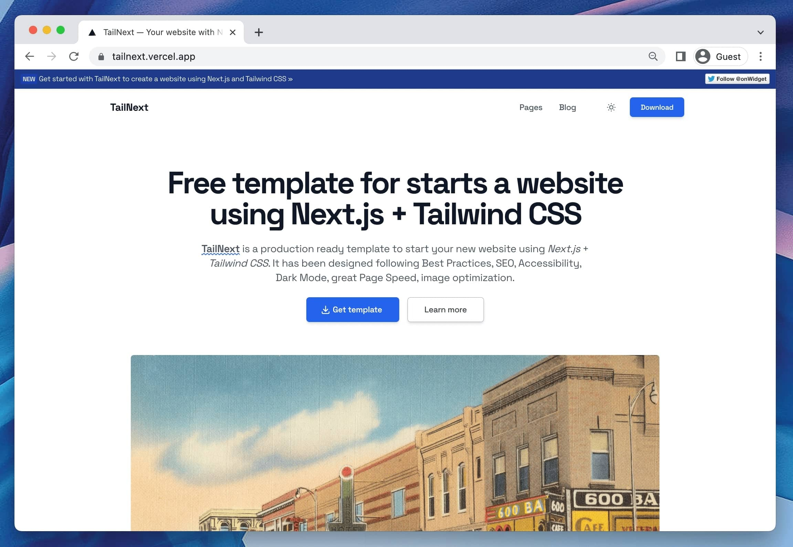

# TailNext

A production-ready template for building marketing sites and blogs with **Next.js 16**, **React 19** and **Tailwind CSS 4**.

[](https://github.com/arthelokyo/tailnext/blob/main/LICENSE.md)
[](https://arthelokyo.com)



## What's inside

|              |                                                                                       |
| ------------ | ------------------------------------------------------------------------------------- |
| Framework    | Next.js 16 (App Router, Turbopack) with React 19                                      |
| Styling      | Tailwind CSS 4, CSS-first `@theme` configuration                                      |
| Language     | TypeScript 6, strict mode                                                             |
| Content      | MDX through content-collections, frontmatter validated with Zod                       |
| Highlighting | Shiki at build time, light and dark themes                                            |
| Testing      | Every Storybook story runs as a browser test in Vitest, with axe accessibility checks |
| Tooling      | ESLint 9 flat config, Prettier, husky, lint-staged, commitlint                        |

Dark mode, SEO metadata, Open Graph images, JSON-LD, a native sitemap and
security headers are wired up rather than left as exercises.

## Getting started

```bash
git clone https://github.com/arthelokyo/tailnext.git
cd tailnext
npm ci
npm run dev
```

Then open <http://localhost:3000>.

Node 24 is the target. `.nvmrc` pins it, and `engines` sets the floor at 20.9.

## Commands

| Command                               | Description                                                |
| ------------------------------------- | ---------------------------------------------------------- |
| `npm run dev`                         | Development server on `localhost:3000`                     |
| `npm run build`                       | Production build to `.next/`                               |
| `npm start`                           | Serve the production build                                 |
| `npm test`                            | Run every story as a browser test, including accessibility |
| `npm run test:watch`                  | Same, in watch mode                                        |
| `npm run storybook`                   | Storybook on `localhost:6006`                              |
| `npm run build-storybook`             | Static Storybook build                                     |
| `npm run lint` / `lint:fix`           | ESLint                                                     |
| `npm run typecheck`                   | TypeScript, no emit                                        |
| `npm run prettier` / `prettier:check` | Formatting                                                 |

## Project structure

```
app/                      App Router routes, sitemap, robots, OG images
  (blog)/blog/            Blog index and /blog/[slug]
  (legal)/                Privacy and terms
  (pages)/                About, contact, faqs, pricing, services
src/
  assets/styles/base.css  Tailwind entry point and @theme tokens
  components/
    atoms/                Logo, theme toggle, menu toggle, providers
    common/               Building blocks shared by widgets
    widgets/              Page sections composed from data
  content/
    blog/                 Posts as .mdx
    legal/                Privacy and terms as .mdx
  shared/data/            Page copy, typed
  stories/                Storybook stories, which double as the test suite
  utils/                  Metadata helpers
content-collections.ts    Content schema and MDX pipeline
src/config.ts             Site name, origin, title, description
```

## Configuration

Site-wide settings live in `src/config.ts`. The canonical origin can be
overridden per environment with `NEXT_PUBLIC_SITE_ORIGIN`, which is useful for
preview deployments and forks; see `.env.example`.

Design tokens are defined in `src/assets/styles/base.css` under `@theme`.
Tailwind 4 has no `tailwind.config.js`.

## Writing content

Add an `.mdx` file to `src/content/blog`:

```mdx
---
title: 'Post title'
description: 'Shown in search results and social cards'
publishDate: 'Nov 02 2022'
image: 'https://images.unsplash.com/photo-...'
tags: [markdown, blog]
---

Your content. Code blocks are highlighted by Shiki.
```

Frontmatter uses the maintained `@11ty/gray-matter` parser in both Content
Collections and the MDX compiler. YAML is supported; executable JavaScript
frontmatter is intentionally unsupported. Keep `publishDate` quoted to match
the string schema. Unquoted YAML timestamps now remain strings instead of
legacy JavaScript `Date` objects; consumers needing dates must convert them
explicitly.

Run `npm run test:content` for parser and MDX regressions. To compare YAML with
the previous parser, install `gray-matter@4.0.3` in a separate temporary
directory and set `LEGACY_MATTER_PATH` to its resolved entry point.
This comparison dependency is not installed in the application.

Frontmatter is validated at build time. A missing title or an unparseable
`publishDate` fails the build with a specific message instead of rendering
something wrong.

Set `draft: true` to keep a post out of the site.

## Testing

There is no separate test directory. Stories are the tests:

```bash
npm test
```

Each story renders in headless Chromium and is checked with axe. An
accessibility violation fails the run, so regressions surface before review.

## Deploy

The build is a standard Next.js application and runs anywhere Next.js does.

[](https://vercel.com/new/clone?repository-url=https%3A%2F%2Fgithub.com%2Farthelokyo%2Ftailnext)
[](https://app.netlify.com/start/deploy?repository=https://github.com/arthelokyo/tailnext.git)

Set `NEXT_PUBLIC_SITE_ORIGIN` to the deployed domain so canonical URLs, the
sitemap and social cards point at the right place.

## Contributing

See [CONTRIBUTING.md](./CONTRIBUTING.md). Security reports go through
[SECURITY.md](./SECURITY.md), which also documents the known advisories in the
MDX toolchain.

## License

MIT — see [LICENSE.md](./LICENSE.md).
